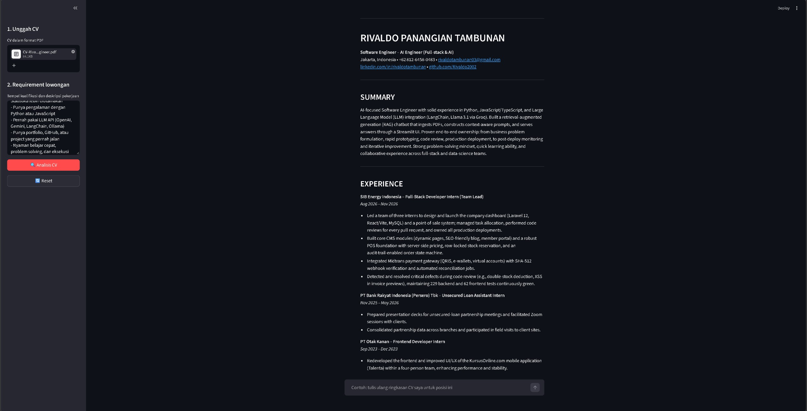

# 📄 CV Reviewer

Aplikasi AI untuk merevisi CV agar sesuai dengan requirement lowongan kerja. Unggah CV (PDF), tempel kualifikasi lowongan, lalu dapatkan analisis kecocokan dan saran revisi yang siap dipakai.

**Demo:** [isi link Streamlit Cloud]



## Fitur

- **Skor kecocokan** CV terhadap lowongan (0–100) beserta alasannya
- **Requirement yang sudah terpenuhi** lengkap dengan bukti dari CV, dan **yang belum terlihat**
- **Saran revisi per bagian** dalam format sebelum → sesudah
- **Kata kunci ATS** dari lowongan yang perlu ditambahkan
- **Chat lanjutan**: minta tulis ulang ringkasan, satu pengalaman, atau email lamaran
- Tidak mengarang: model dilarang menambahkan pengalaman atau skill yang tidak ada di CV

## Arsitektur

```
CV (PDF) ─► PyPDFLoader ─► teks per halaman
                               │
               ┌───────────────┴────────────────┐
         CV pendek (≤12.000 karakter)     Dokumen panjang
         dikirim utuh ke prompt           RAG: chunk ─► HuggingFace embeddings ─► Chroma
                                          ─► retriever MMR (pertanyaan + requirement)
               └───────────────┬────────────────┘
                               ▼
Requirement lowongan + riwayat chat + permintaan ─► Prompt (system + human)
                               ▼
                    GPT-OSS 120B (Groq API) ─► analisis & saran revisi
```

Keputusan desain:

- **Full context vs RAG.** CV biasanya 1–2 halaman, jadi dikirim utuh agar tidak ada bagian yang terlewat. RAG hanya dipakai untuk dokumen panjang yang tidak muat di prompt.
- **Prompt engineering.** System prompt memberi peran (career coach/recruiter), format jawaban yang konsisten, dan aturan anti-halusinasi: hanya fakta dari CV.
- **Riwayat percakapan.** Tiga tanya-jawab terakhir ikut dikirim agar pertanyaan lanjutan dipahami.

## Teknologi

Python · Streamlit · LangChain · Chroma · HuggingFace sentence-transformers · Groq API (GPT-OSS 120B)

## Menjalankan di lokal

```bash
git clone <repo-ini>
cd cv-reviewer
python -m venv .venv
# Windows: .venv\Scripts\activate   |   Mac/Linux: source .venv/bin/activate
pip install -r requirements.txt
cp .env.example .env   # lalu isi GROQ_API_KEY (gratis di console.groq.com)
streamlit run app.py
```

Butuh Python 3.10 atau lebih baru.

## Deploy ke Streamlit Community Cloud

1. Push repo ini ke GitHub (file `.env` tidak ikut karena ada di `.gitignore`).
2. Buka share.streamlit.io, pilih repo dan `app.py`.
3. Di **Advanced settings → Secrets**, isi: `GROQ_API_KEY = "kunci-anda"`.

## Batasan

- CV hasil scan (gambar) belum didukung karena belum ada OCR.
- Aplikasi memberi saran revisi; file CV baru tetap disusun sendiri oleh pengguna.
- Free Plan Groq membatasi sekitar 8.000 token per menit untuk GPT-OSS 120B. Jika muncul error 429, tunggu sekitar satu menit lalu coba lagi. Model bisa diganti lewat `LLM_MODEL` di `app.py` (misalnya `openai/gpt-oss-20b`).